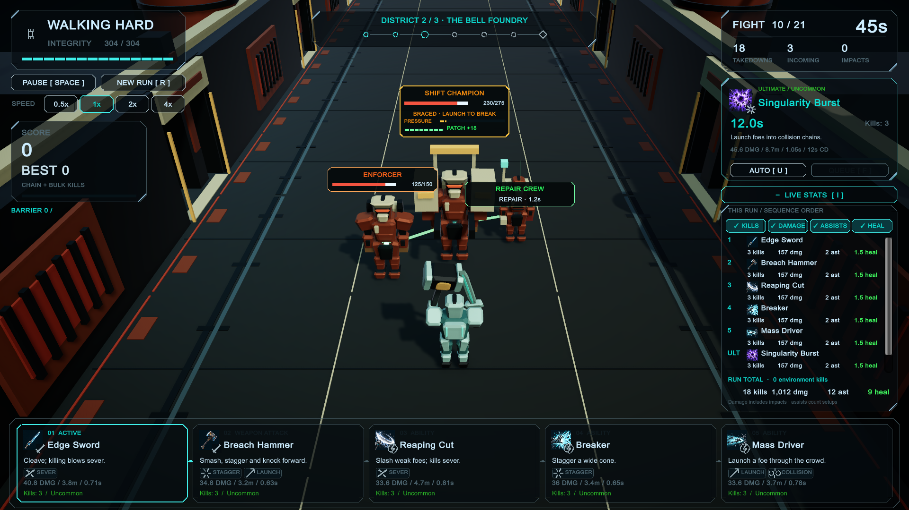
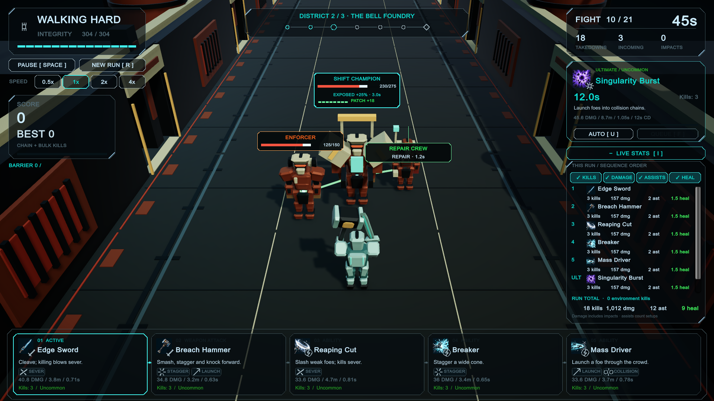
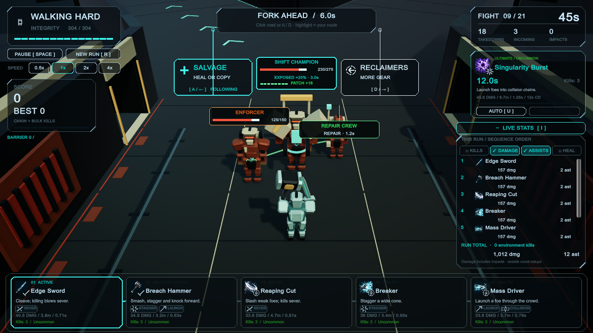

# Durable threats and live stats — 0.8.1

Verified November 15, 2026. Local Windows delivery uses the existing **Walking Hard** desktop updater and `%USERPROFILE%/Games/WalkingHard/Current`. No separate playable installation is retained. [Build provenance](provenance.json) records the assemblies used during tuning and final acceptance.

## Player behavior

From journey fight three: Linebreakers have 2× ordinary encounter health; Enforcers/Freight Brutes 3×; repair crews/Bellkeepers 1.5×. Raiders, vulnerable ranged roles and boss health are unchanged. The opening two fights keep their earlier health while the player obtains a weapon and third ability. These ratios are not hit-count gates. Older saved actors retain their saved health.

Each eligible Elite Shift has one 5.5× Freight Champion, one repair escort and a lighter heavy screen (one forced heavy per five arrivals rather than two). The first district cannot place that formation in either opening fight. Braced champions take normal damage but resist stun/interrupts; stagger and impacts build pressure, counted once per originating action including pairs and derived contacts. Launch breaks the brace immediately. Eight visible seconds also opens it. Exposure lasts three seconds, permits normal control and adds 25% incoming damage. Opening armor plates and a cyan core match the labeled state. Ordinary specialists retain their light-stagger counterplay.

The elite cannot finish while its champion lives. After arrivals stop, the Walker waits during champion cleanup instead of leaving the target behind. A recent credited displacement can still ring it out. Completion awards the ordinary four salvage and extra six once, before route selection changes; other survivors can carry under existing rules. The champion cannot. Deferred arrival logic still permits its one repair escort after arrivals expire. Existing weapon, augment, damage, fusion and lifesteal rules are unchanged.

Damaged durable enemies have health bars with recent-hit trails. Repair protection has a separate green bar, including a PATCH BROKEN cue even when the final protected hit removes no health. Shield guard/open states and champion pressure/exposure are labeled separately. There is no universal wall of fodder health bars.

**I / LIVE STATS** toggles the right sidebar. **Kills / Damage / Assists / Heal** toggle independently and preferences persist across launches. Sequence order and ultimate are explicit. Item ownership survives moves, fusion and checkpoint restoration. Separate paired weapons have separate rows; shared fists and 2H owners have one row labeled with both positions, avoiding doubled totals. Gear/stored history is a separate aggregate; environmental kills are identified in run totals. Damage is actual health removed, including impacts; healing belongs to its source item; assists are confirmed setup payoffs, not additional kills. No DPS estimates or fabricated attribution are introduced.

## Matched encounter measurements

[Raw 126-case results](balance-final/samples.jsonl), [summary](balance-final/summary.json), [district/build breakdown](balance-final/by-build-district.csv), [analysis script](analyze.py).

Production PhysX, seven authored builds (pinball, storm, sever, gun, cut-and-carry, close quarters, Siphon), three districts and three seeds per build/district. Each pair uses the same seeded elite/freight/repair route and fixed equipment: Common/Uncommon/Rare by district. Initial integrity is 80% of the normal equipped maximum to measure healing headroom. No health override. The baseline uses previous role HP, previous heavy-screen frequency and no champion; the candidate uses the new package. All 63 cases per condition finished, with zero order errors or visible spawns. The first-two-fight safeguard is outside these fight-3/10/17 samples.

| Measure | Baseline | Candidate |
| --- | ---: | ---: |
| Durable enemies: mean damaging actions to death | 3.48 | 4.99 |
| Durable enemies: first damaging action kills / hit enemies | 1.97% | 0.27% |
| Fragile roles: first damaging action kills / hit enemies | 13.01% | 13.96% |
| Mean bodies generated per encounter | 45.65 | 44.21 |
| Mean surviving enemies at completion | 8.13 | 9.54 |
| Mean actual healing per encounter | 65.69 | 64.21 |
| Mean simulation seconds | 53.02 | 54.06 |

One action means one damaging originating action ID; paired contacts and delayed derivatives share it. Living enemies are censored from mean actions-to-death and reported separately. First-action kill rates are measured across hit enemies, not all spawns. These are modest fixed-loadout samples, not an estimate of how often arbitrary players one-shot enemies with Legendary equipment.

The **21 champions all died in their own encounter**, averaged **9.86 damaging actions**, and completed **37 of 53 initiated crew actions**. Their brace demonstrably avoids permanent interruption. Ordinary durable crew completions were 603 baseline versus 591 candidate; health alone does not solve ordinary specialist suppression. That behavior remains intentional counterplay. Body generation fell about 3.2%, while carry rose about 1.4 enemies per encounter. The package retains fragile bodies but increases pressure; it does not establish equal build strength.

## Run-level findings and tuning

The first unrestricted-health implementation caused the automated gun draft to die in fight two, versus fight ten in its baseline. This prompted preserving the earlier HP values in the first two fights. The adjusted gun draft reached fight nine; its Common Rail Rifle and setup-heavy sequence still lag in sustained encounters. This is a recorded balance limitation, not counted as a successful completion fixture. [Outcome](gun-final/outcome.json), [iteration evidence](iteration-notes.json).

Two normal-health pinball drafts completed the 21-fight journey with ordinary offers, all nine roads, 20 item picks, five augment picks, 30 Sparks and exact checkpoint graph round-trips at fights 7, 14 and 20:

| Seed | Kills | Ending integrity | Measured 1× combat | Estimated run including decisions |
| --- | ---: | ---: | ---: | ---: |
| 1741, before opening safeguard | 1,080 | 314.7 | 20.01 min | 32.09 min |
| 4319, with opening safeguard | 1,054 | 7.5 | 19.26 min | 31.35 min |

Sources: [1741](pinball-journey/report.json), [4319](pinball-final/report.json). Decision estimates add 20 seconds per reward and 25 per road stop; they are not observed human playtime. Narrow completion at 4319 and the gun losses justify continued build-balance work rather than claiming a universal win rate. No weapon balance changes were folded into this pass.

## Verification and visual acceptance

- **55 final rendered assertions:** production damage/control, champion wind-up completion under light damage, per-action pressure cap, real launch/exposure, natural rebrace/opening, ordinary interrupts, separate protection breaks, paired/2H/fist attribution, fusion/reordering, metric pointer toggles, checkpoint totals/state, older actor decode, elite completion/payout and road-click exclusion. [Report](acceptance/report.json).
- **126 matched production encounters:** no sequence-order errors or visible creation; 176 assertions including the pre-safeguard focused suite. [Report](balance-final/report.json).
- **15 combat regression scenarios:** all passed, each also executing 761 production-effect assertions; covers physics, pair order, mount identity, cuts, collision budgets, ultimates, delayed effects, fusion and attribution. [Results](core.json).
- **136 journey-flow assertions:** Play/Office, seeded itineraries, road input, specialist behavior, current/legacy saves, progression/currency and dormant bodies. [Report](journey-checks/report.json).
- Rendered captures inspected at **1920×1080, 1280×720, 1024×768 and 2560×1080**. Minimum scaling improves the new labels/sidebar at small resolutions. Scroll retains access to extra rows. Both road choices stay visible and clickable with stats expanded; clicks inside the stats panel cannot choose a road beneath it.

The matrix and core suite were run before the opening safeguard and final small UI/deferred-escort fixes; the second full journey includes the safeguard. The final player reruns the focused rendered suite, including all new edge cases. [Provenance](provenance.json) distinguishes these builds rather than presenting them as one identical binary.

Reproduce focused checks with `-durabilityReview -saveDirectory <isolated profile> -reviewOutput <empty output>`, adding `-batchmode -nographics` for headless checks or `-durabilityBatch` for the matched matrix. Never use a real profile for QA. Full journey comparisons use `-journeyReview -journeyFullRun -journeyPolicy pinball -seed 4319`; `-durabilityBaseline` is only interpreted by that developer review.
