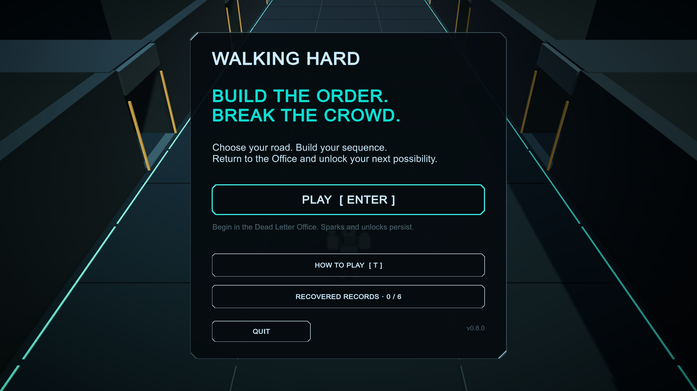
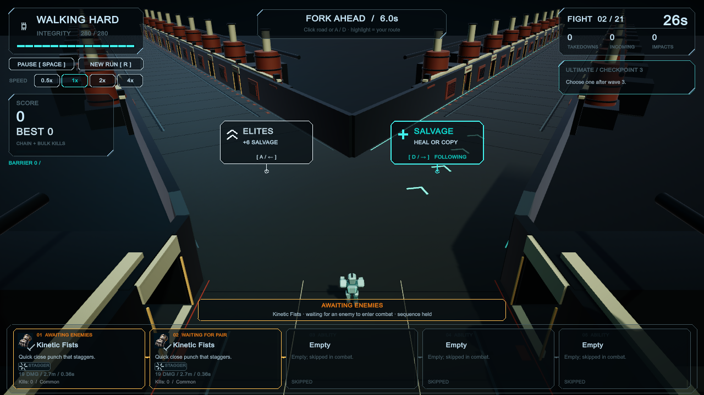
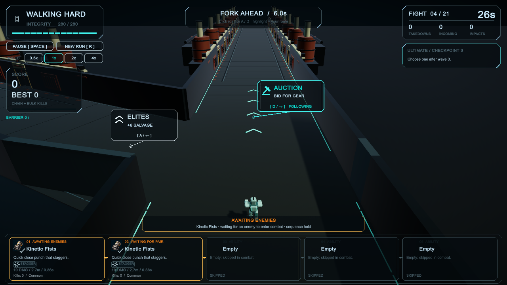
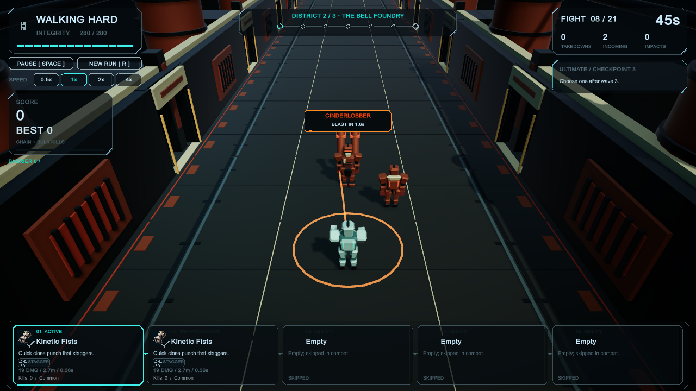
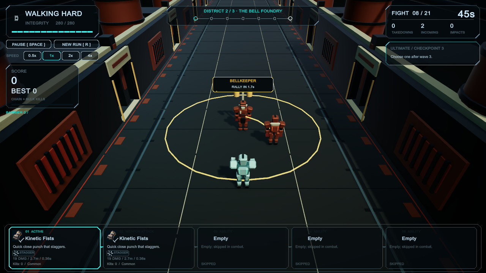
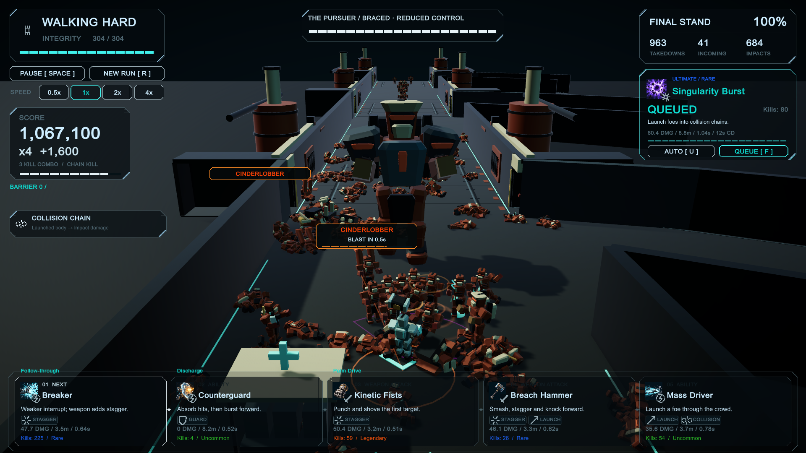

# Long journey verification

Verified November 15, 2026. Build: `Build/WalkingHard-Current/WalkingHard.exe` with Unity 6000.3.27f1. Branch: `feature/long-journey`, stacked on `feature/cinderworks-chapter`. The desktop **Walking Hard** shortcut opens this tested local build; this is not a published release.

## Delivered behavior

One **Play** button opens the Dead Letter Office. The current journey contains three seven-encounter districts, nine physical forks and three bosses. Old mode buttons and repeat-seed entry points are removed from the player flow. Earlier short checkpoints are archived intact; Office currency, unlocks and lore records remain. The tutorial returns to the Office.

Clicking the road floor or its sign selects it; only that road has cyan arrows and edge lighting, and its sign says FOLLOWING. Changes are accepted until the six-second lock. Production pointer fixtures cover both roads, 720p, rotated roads, UI rejection, pause and deadline commitment.

Linebreakers, Cinderlobbers and Bellkeepers have distinct equipment, labeled countdowns, and red lanes / orange blast circles / gold rally circles and tethers. Stagger and launch cancel their actions. Bell Foreman adds specialist reinforcement calls and a bell crown; Pursuer finishes the journey. Specialist labels avoid boss and fork panels. Resuming a checkpoint does not replay old fusion popups over combat.

## Pacing and full runs

Normal arrivals are 40/45/50 seconds by district, with the existing eight-second cleanup limit. Bosses end on defeat. The first two gates repair 25% maximum integrity and offer service. All six nonboss formations are shuffled per district; two junctions offer repair versus combat, one offers an RNG event versus elites. Selected combat paths bias mixed rewards. The run provides 20 ordinary item choices and five augment choices, including opening drafts; shop/event acquisitions are extra.

Two native PhysX runs used normal health, ordinary offers, the automated pinball selection policy and normal event/service rules. No fixture health or predetermined equipment was used. Combat time counts 1x advance calls including hit stop and the final reveal; decision time is estimated, not measured player behavior.

| Seed | Result | Kills | Ending integrity | 1x combat | Estimated run |
| --- | --- | --- | --- | --- | --- |
| 1741 | All 21 encounters complete | 1,039 | 293.5 | 20.83 min | 32.91 min |
| 4319 | All 21 encounters complete | 1,011 | 106.2 | 19.37 min | 31.45 min |

The estimate adds 20 seconds for each of 25 picks and 25 seconds for each of nine route stops. It is a pacing model: actual event choices, gate service, build management, speed settings and player familiarity change duration. These two seeds establish functional completion and a plausible roughly-30-minute target, not population win rates or equal build strength. The initial 60/65/70-second pacing sample estimated 39.89 minutes; shorter fights preserve the longer route while avoiding unnecessary waiting.

Both final runs preserved strict action order, concealed spawns, all nine road choices, persistent body identity, all three specialist types, 30 banked Sparks, and exact combat-graph restoration at checkpoints 7, 14 and 20. Sources: [1741](long-journey/full-1741.json), [4319](long-journey/full-4319.json), [initial pacing](long-journey/pacing-baseline.json).

## Checks

- **137 current-flow assertions:** production Play and road input, 100 seeded itineraries, specialist actions and interruptions, current checkpoint restoration, prior checkpoint byte-preserving retirement, district seals/victory/currency, distant-body sleep/save/wake. [Report](long-journey/fixtures.json).
- **Fresh process:** restored a real encounter-20 checkpoint, retained 814 dormant bodies, completed the Pursuer, preserved 30 Sparks without replay payment, and retained exact graph restoration. Eight assertions. [Report](long-journey/fresh-process.json). Its timing excludes earlier hit stop and is not a full-run measurement.
- **15 combat regression scenarios:** all passed, including ordered pairs, weapon hold/mount, fusion, manual ultimates, speed clocks, delay labels, attribution and hidden entry. Each process also passed 761 production mechanic assertions. [Compact results](long-journey/core.json).
- **Physical road regression:** 45 native assertions plus 761 production mechanic assertions; independent walls, movement, pause, timeout, route rewards, rotated road/finale and speed cap. [Report](long-journey/physical-forks.json).
- **Tutorial:** 174 model assertions and 1,376 rendered assertions, including production mouse handlers and text fitting. [Counts](long-journey/tutorial.json).
- **Legacy chapter compatibility:** 232 assertions plus 761 production assertions. The old six-encounter fixture is explicitly developer-only; public Play always starts the long journey. [Report](long-journey/legacy-chapter.json).

No item effects, rarity odds, fusion rules or paired/two-handed balance were changed. The item-variety suite was not rerun; combat regression and full journeys cover the changed encounter/reward schedule.

Distant old/sleeping bodies outside the combat view can leave active physics beyond 55m; approaching within 45m wakes the same actor. All IDs, bones, cuts, poses and velocities persist in the checkpoint. Final runs retained 1,039 and 1,011 bodies, with 814 and 792 dormant respectively. This bounds unnecessary physics work; no frame-rate guarantee is inferred from the headless runs.

## Visual inspection

Native captures were inspected at 720p and 1080p. Checks covered title/Office clarity, selected-road arrows and sign agreement, the rotated junction, specialist silhouettes and complete danger footprints, boss-label separation, and the final boss after a fresh-process resume.

Run fixtures with `-journeyReview -saveDirectory <isolated-profile> -reviewOutput <output>`. Add `-journeyFullRun -seed 1741` for a full journey and `-batchmode -nographics` for headless execution. Add `-journeyResumeRun` to continue an isolated saved journey. Never point review fixtures at a real player profile.
