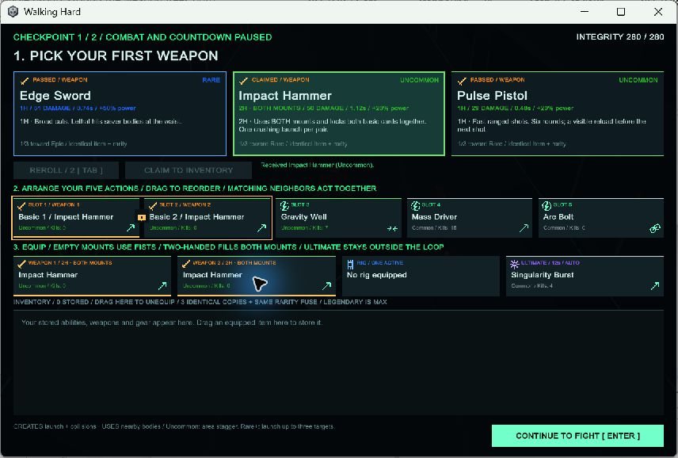

# Walking Hard 0.4 verification

Unity 6000.3.27f1 Windows build succeeded without C# warnings/errors. Final gameplay assembly SHA-256: 74c49ecd88a210158b27021448e661200ce47d60e5be58eb2a9d39974dfb12e8.

Nine standalone scenarios passed. Named weapon/Tempest scenarios use explicit equipment fixtures to exercise their mechanics independently of draft luck. Ordinary sequence, manual-ultimate and reroll scenarios retain actual randomized offers.

| Scenario | Kills | Severs | Reloads | Body impacts | Max cascade hop | Ultimates | Banked score |
| --- | ---: | ---: | ---: | ---: | ---: | ---: | ---: |
| sequence-1741 | 98 | 17 | 0 | 59 | 2 | 8 | 84,200 |
| sequence-4319 | 97 | 24 | 0 | 68 | 2 | 8 | 75,700 |
| sword-1741 | 102 | 17 | 0 | 62 | 2 | 8 | 89,900 |
| hammer-1741 | 100 | 0 | 0 | 66 | 2 | 8 | 88,200 |
| rifle-1741 | 102 | 0 | 2 | 57 | 2 | 8 | 86,700 |
| twin-1741 | 104 | 0 | 4 | 44 | 2 | 8 | 95,200 |
| tempest-1741 | 103 | 22 | 0 | 65 | 2 | 6 | 88,500 |
| manual-1741 | 99 | 17 | 0 | 64 | 2 | 8 | 92,700 |
| reroll-1741 | 102 | 22 | 0 | 71 | 2 | 8 | 81,000 |

All runs completed three waves with zero visible spawns and zero sequence-order errors. Attributed kills matched total kills in every run. Each ultimate obeyed its recorded recharge deadline. Both side-door types and the horizon were exercised, and real physics contacts occurred.

Contract checks cover movable permanent basics; same-type adjacency including the repeat boundary; two-handed occupancy and grouped movement; storage/replacement; exact same-item/same-rarity fusion; preserving equipped positions; nine commons to Rare and 81 to Legendary; Legendary cap; 100,000 seeded rarity rolls within one percentage point of each stated probability; equipping higher-rarity fist drops; ultimate-slot compatibility; single-use rewards; exhausted rerolls; delayed kill credit after fusion; and combo scoring/banking/cap.

Native Windows visual and interaction checks covered:

- Dragging a draft card into an empty position and claiming it without leaving the checkpoint.
- Moving a basic attack to position 5 and inserting abilities before weapon attacks.
- Combat HUD with always-automatic sequence, independent ultimate toggle/countdown, kill counters and live score.
- Shared two-handed bounding box and lock. Dragging either basic moves both cards together.
- Storing a two-handed weapon frees both mounts; dragging it back from inventory restores occupancy and the locked pair.
- Category icons/colors, rarity labels/borders, actual stat lines, claimed-reward state and contextual synergy inspection.

Launcher checks passed: valid installation, checksum rejection, failed-build protection, archive containment and offline fallback. PowerShell parsing and git diff whitespace checks passed.

Limits: procedural art; authored waist separation rather than arbitrary mesh slicing; three-wave pacing; initial rarity/scoring balance. Physics outcomes vary slightly between runs and machines. This is functional validation, not a claim of production balance or exhaustive hardware coverage.
